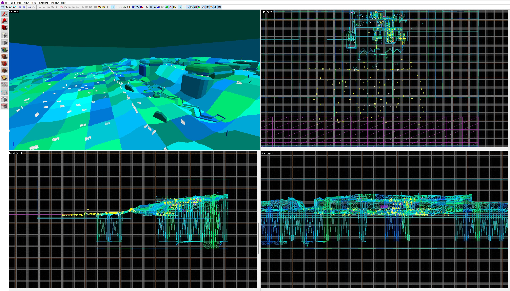
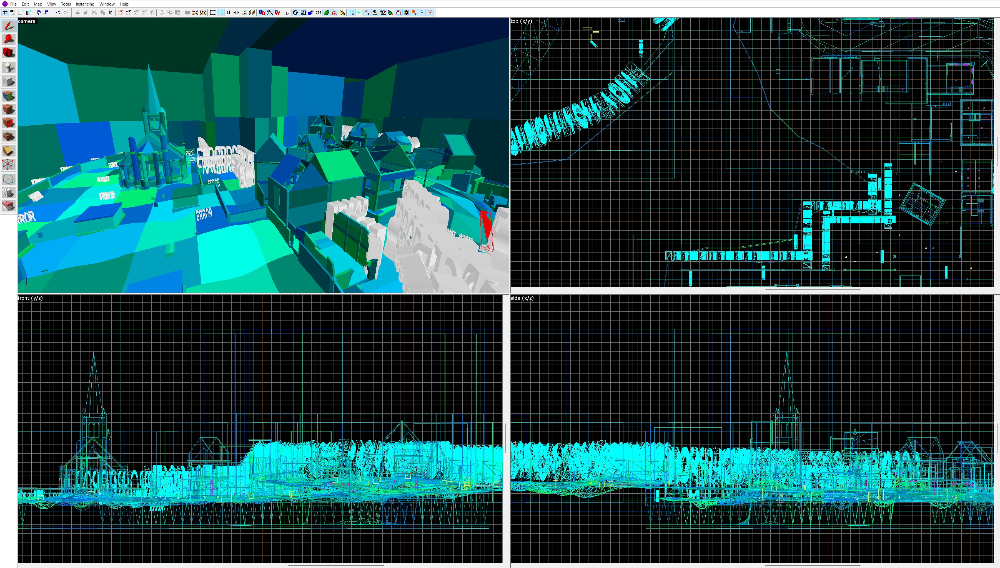

# MOH Map to VMF

A small Python converter for turning `.map` files saved by MOHRadiant into Valve Map Format (`.vmf`) files that can be opened in Hammer. It targets maps for Medal of Honor: Allied Assault, Spearhead, and Breakthrough, including maps authored directly in MOHRadiant.

MOHAA is based on a modified Quake III engine, so its terrain and map conventions are not identical to stock Quake III. This is not a general-purpose converter for every Quake-family map dialect.

## Hammer++ Validation

The converted maps have been opened and inspected in [Hammer++](https://ficool2.github.io/HammerPlusPlus-Website/). Example editor views:

<p align="center">
	
	
</p>

## Features

- Converts classic brush faces and entities to VMF solids.
- Converts MOH `terrainDef` heightfields to Source displacement brushes.
- Supports the MOH terrain orientation flag.
- Converts quadratic `patchDef2` patches to triangle brushes.
- Converts MOH static model entities to Source `prop_static` entities and `.mdl` paths; Source-compatible model assets must be supplied separately.
- Replaces materials beginning with `sky/` with `TOOLS/TOOLSSKYBOX`.
- Maps common Quake tool textures to their Source equivalents.

## Requirements

- Python 3.10 or newer.
- No third-party Python packages are required.

## Usage

From this folder, run:

```powershell
python map_to_vmf.py path\to\input.map path\to\output.vmf
```

If the destination is omitted, the converter writes a `.vmf` next to the source file:

```powershell
python map_to_vmf.py path\to\input.map
```

## Map Scale

MOH's effective world scale does not correspond directly to stock Quake III/Source Engine player scale. For map proportions closer to the Source Engine, uniformly scale the converted map to 0.75 in Hammer as a starting point. The converter preserves the original coordinates and does not apply this adjustment automatically.

## Terrain Format Notes

The converter handles the MOHRadiant terrain forms currently understood by this project:

- The three-value dimensions line is read as width, height, and terrain flags. Legacy MOH samples are spaced 64 world units apart.
- A four-value dimensions line is treated as width, height, `scale_x`, and `scale_y`.
- The terrain origin supplies the base position. Height samples are vertical offsets from its Z coordinate.
- Flag zero keeps the row-major sample order. A positive flag transposes the samples and reverses the brush winding.
- Displacement patches use Source powers 2 through 4. The converter tiles terrain grids into aligned square patches and reports an error when the grid cannot be tiled at those powers.
- Height samples are consumed as written in the `.map` file; the converter does not apply additional game-specific scaling.

The official Medal of Honor Mod Tools releases include source `.map` files that were used as conversion inputs.
Thanks to [wfowler1](https://github.com/wfowler1) for [bsp-decompiler](https://github.com/wfowler1/bsp-decompiler), used to decompile the remaining maps in this repository.

## Purpose

This project is intended for educational purposes and for exploring interoperability between MOHRadiant map files and Valve Map Format.
